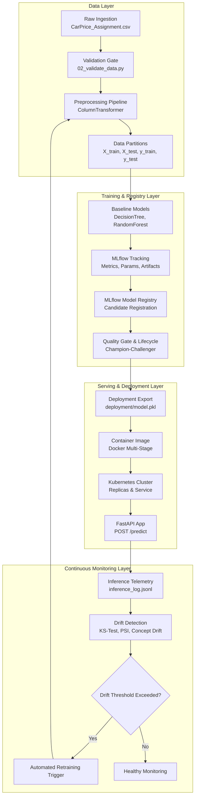

# System Architecture: End-to-End MLOps Car Price Prediction

## System Highlights
1. **Separation of Concerns**: Modular pipeline stages from 01 to 13.
2. **Reproducibility**: Parameterized random states, frozen transformer states, and explicit dependency management.
3. **Automated Governance**: Champion-Challenger promotion with strict $R^2 \ge 0.80$ quality gates.
4. **Cloud-Native Serving**: Containerized FastAPI service with real-time JSONL telemetry logging and health probes.
